# All captured screens — Russian Open Field Studio

Actual Playwright Chromium screenshots from 2026-10-30T04:59:10.561Z. Screen labels and actions are observed in the current running UI. Synthetic project only; not photographic evidence of a real site.

Navigation: Проект, Чертежи, 3D BIM, Обследование, Инспекции, Сдача объекта, Панель управления, АОСР · КС-2, Экспорт, Интеграции, Справка.

Screenshots captured: 34. JavaScript page errors: 0.

## 01 — Проект и общие реквизиты

**Purpose:** Fill project number, legal participants, contractor and customer; the BAG lookup is Netherlands-specific.

**Visible buttons (sample):** Найти адрес (BAG Нидерланды), Импорт из интеграции, + Добавить участника, Сохранить проект

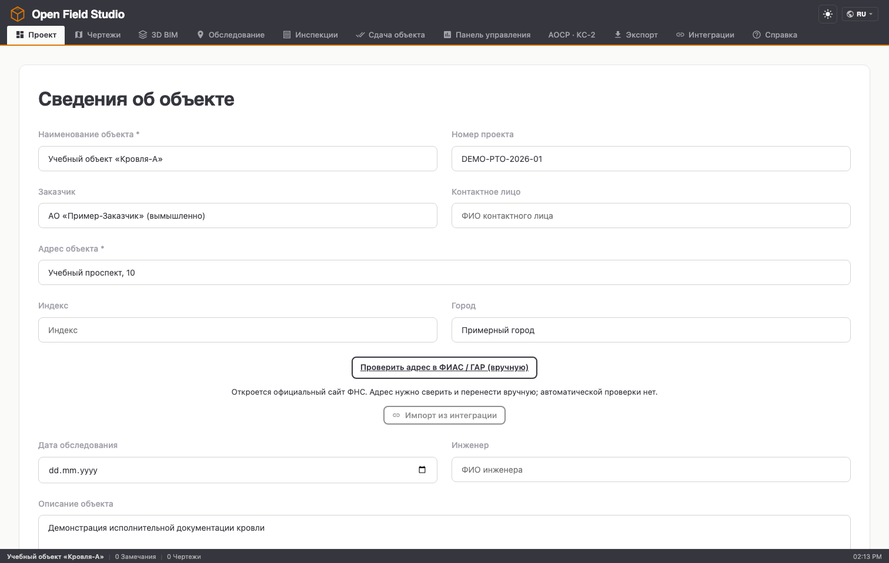

## 02 — Чертежи и загрузка планов

**Purpose:** Upload plans and choose an area for visual site findings.

**Visible buttons (sample):** No buttons visible at capture

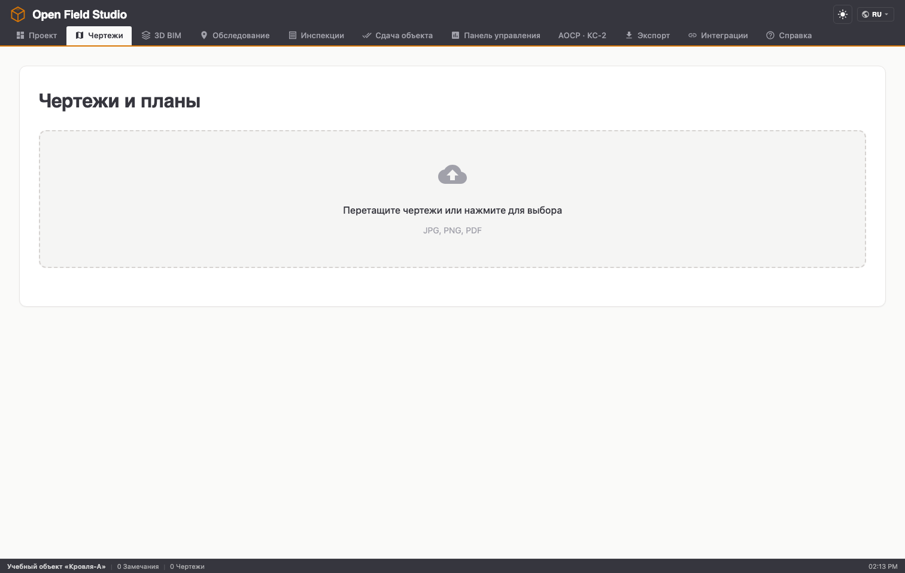

## 03 — 3D BIM и загрузка IFC

**Purpose:** Load a real IFC file to inspect a 3D BIM model; no model was loaded during this capture.

**Visible buttons (sample):** No buttons visible at capture

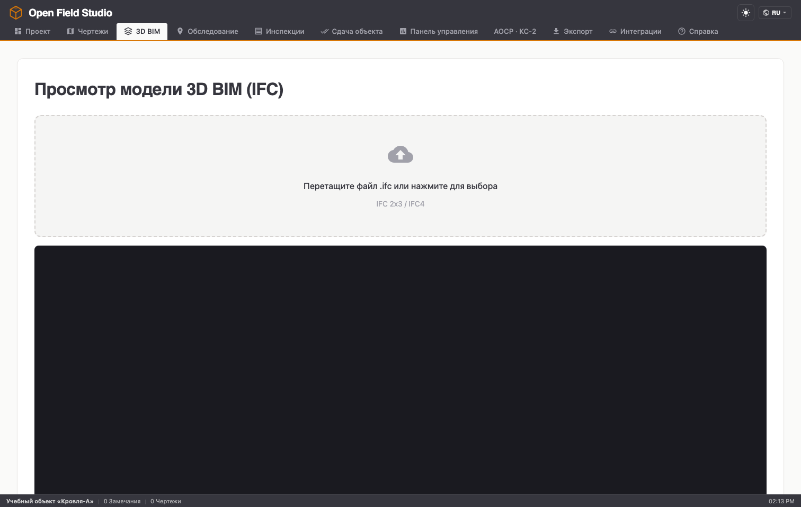

## 04 — Обследование и замечания

**Purpose:** Mark a location on the plan, describe a defect, set its priority and responsible person.

**Visible buttons (sample):** Добавить замечание

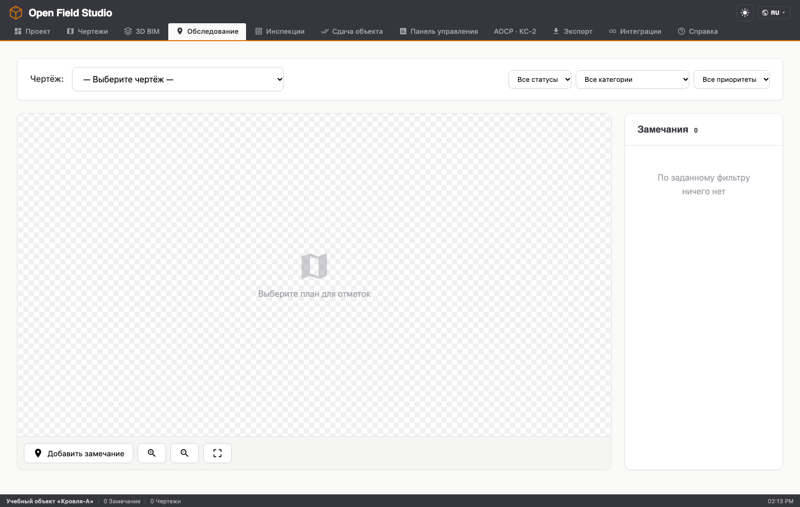

## 05 — Инспекции и шаблоны

**Purpose:** Create and conduct an inspection using a checklist and progress indicators.

**Visible buttons (sample):** + Новая инспекция

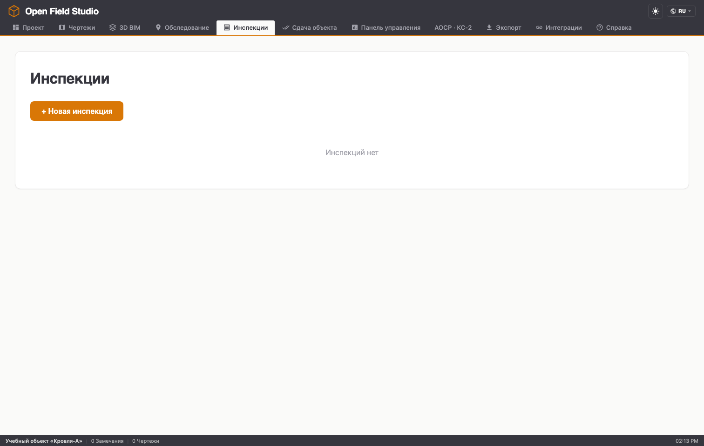

## 06 — Сдача объекта

**Purpose:** Prepare handover, identify participants and track unresolved items.

**Visible buttons (sample):** + Новая сдача

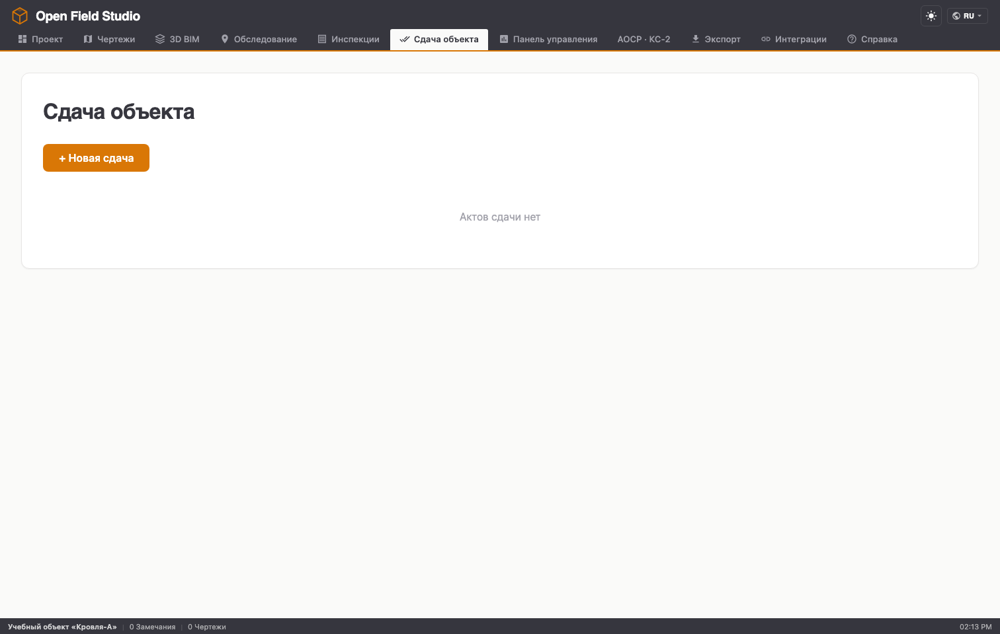

## 07 — Панель управления

**Purpose:** Read counts, statuses, inspectors and recent activity; not a statutory report.

**Visible buttons (sample):** No buttons visible at capture

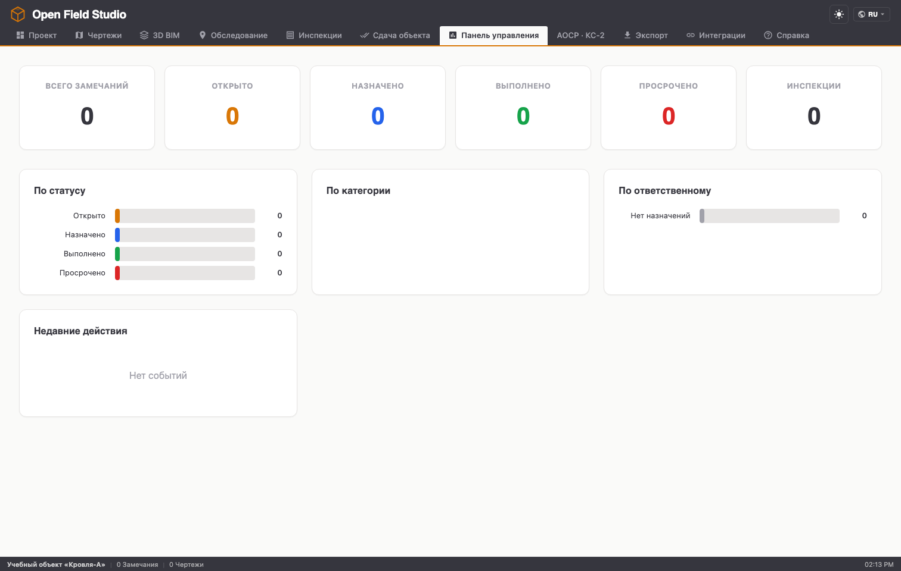

## 08 — Экспорт и резервные копии

**Purpose:** Create reports, BCF, backups and outgoing connector requests; external services were not exercised.

**Visible buttons (sample):** Экспортировать PDF, Скачать HTML, Экспорт в BCF (BIM), Синхронизировать с KYP Project, Сохранить проект (JSON), Загрузить проект, Очистить данные

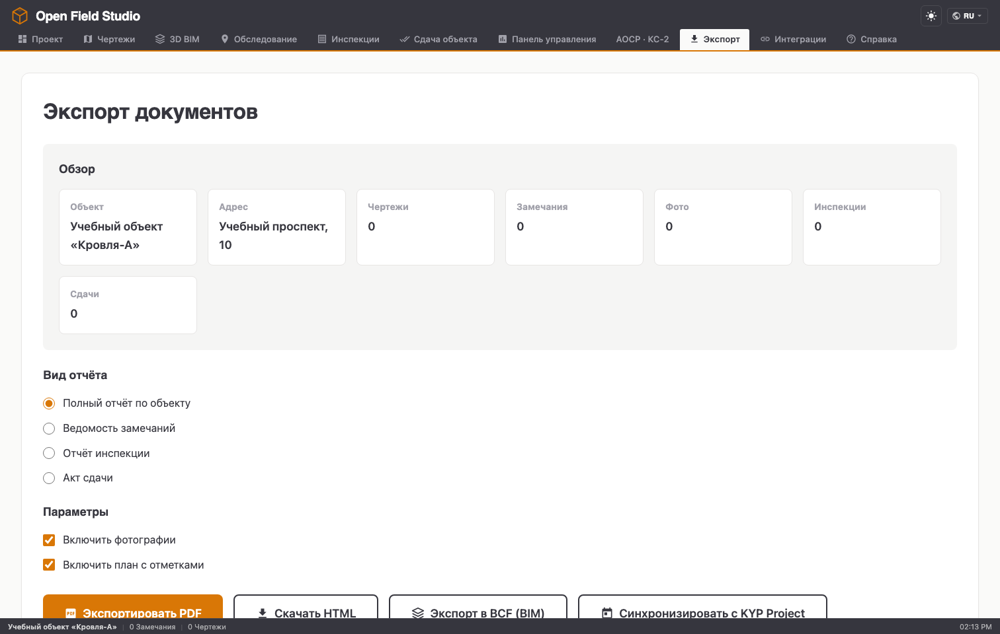

## 09 — Интеграции

**Purpose:** Configure supported external integrations; current vendor set is not Russia-specific.

**Visible buttons (sample):** Настроить, Настроить, Настроить, Настроить, Настроить, Настроить, Настроить, Настроить

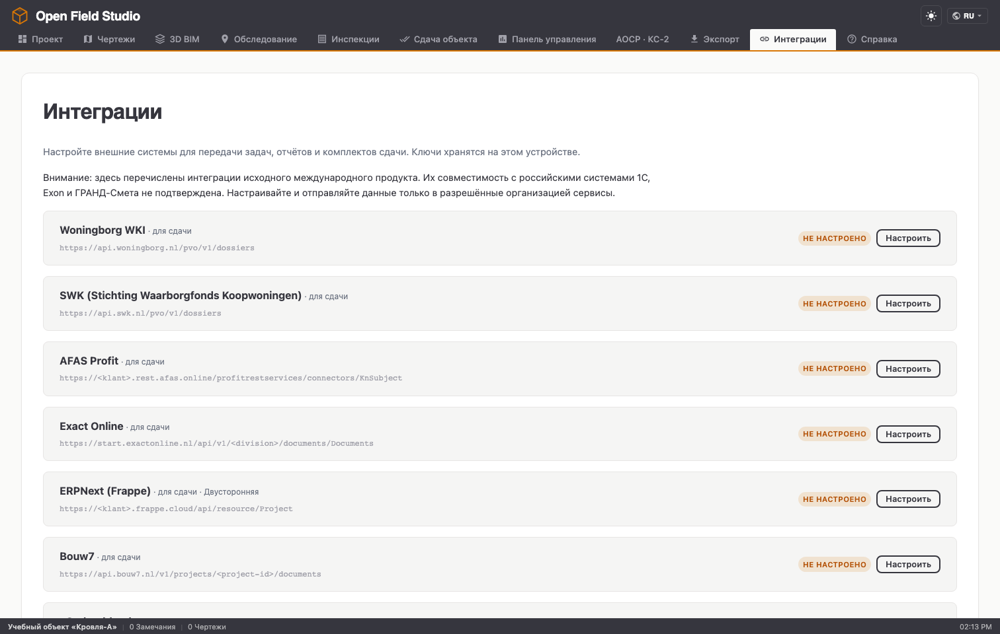

## 10 — Справка

**Purpose:** Read in-app help and instructions.

**Visible buttons (sample):** No buttons visible at capture

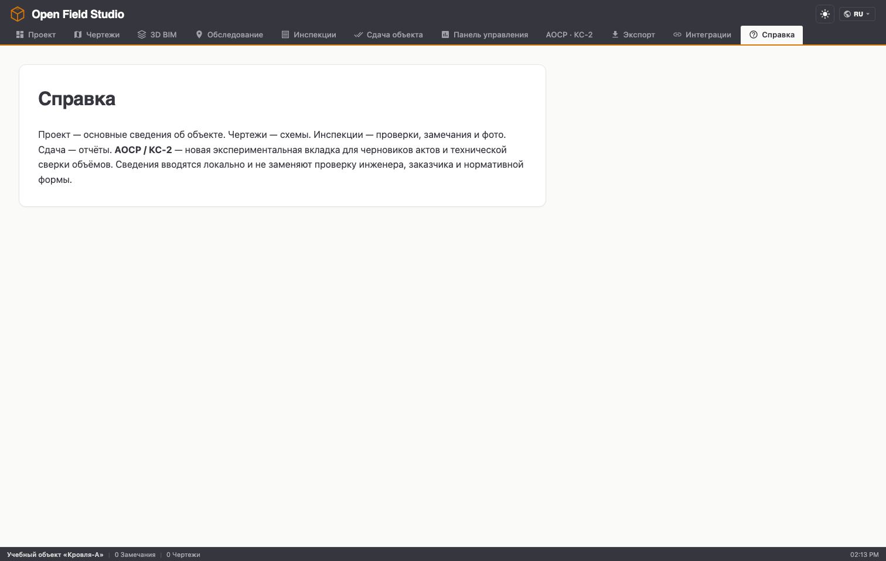

## 11 — АОСР и КС-2

**Purpose:** Work with 15 AOSR acts, OJR date references, material evidence, KS-2 comparison and ZIP pack.

**Visible buttons (sample):** Загрузить вымышленный пример, Сохранить JSON, Печатные черновики (HTML), Экспорт АОСР в Excel (.xlsx), Комплект актов для печати (.xlsx), Собрать комплект ИД с приложениями (.zip), Добавить позицию вручную, Скачать образец CSV, Удалить

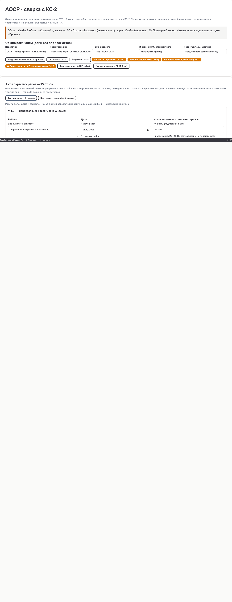

## 12 — АОСР: 15 строк работ и даты

**Purpose:** 15-row AOSR table with work, dates, scheme, documents, quantities and estimates.

**Visible buttons (sample):** Загрузить вымышленный пример, Сохранить JSON, Печатные черновики (HTML), Экспорт АОСР в Excel (.xlsx), Комплект актов для печати (.xlsx), Собрать комплект ИД с приложениями (.zip), Добавить позицию вручную, Скачать образец CSV, Удалить

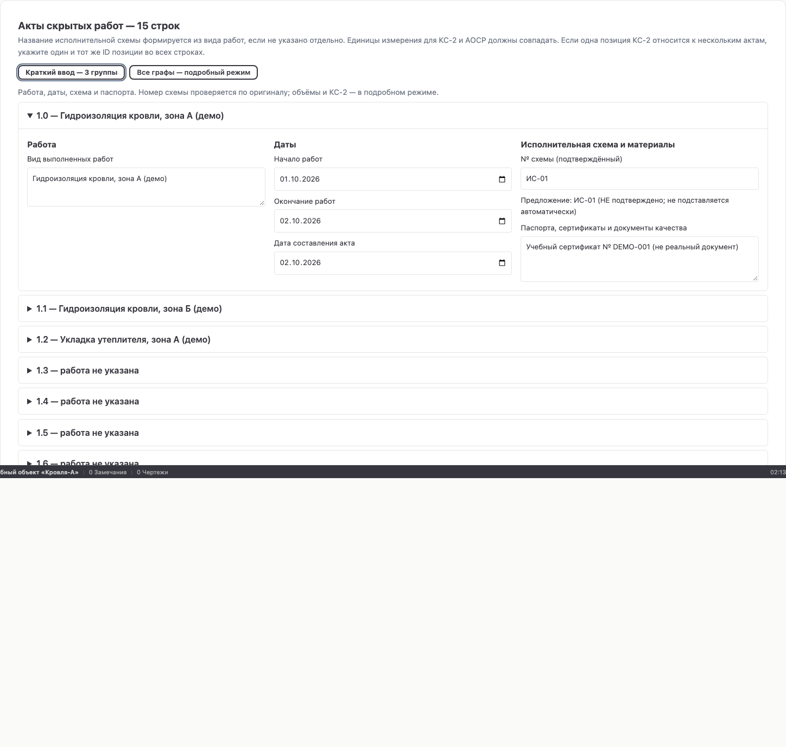

## 13 — КС-2: позиции и количества

**Purpose:** KS-2 quantity rows and import controls.

**Visible buttons (sample):** Загрузить вымышленный пример, Сохранить JSON, Печатные черновики (HTML), Экспорт АОСР в Excel (.xlsx), Комплект актов для печати (.xlsx), Собрать комплект ИД с приложениями (.zip), Добавить позицию вручную, Скачать образец CSV, Удалить

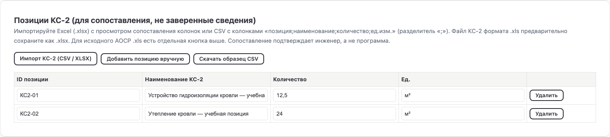

## 14 — Контроль расхождений и предупреждения

**Purpose:** Chronology, missing-data and quantity warnings; these are technical checks only.

**Visible buttons (sample):** Загрузить вымышленный пример, Сохранить JSON, Печатные черновики (HTML), Экспорт АОСР в Excel (.xlsx), Комплект актов для печати (.xlsx), Собрать комплект ИД с приложениями (.zip), Добавить позицию вручную, Скачать образец CSV, Удалить

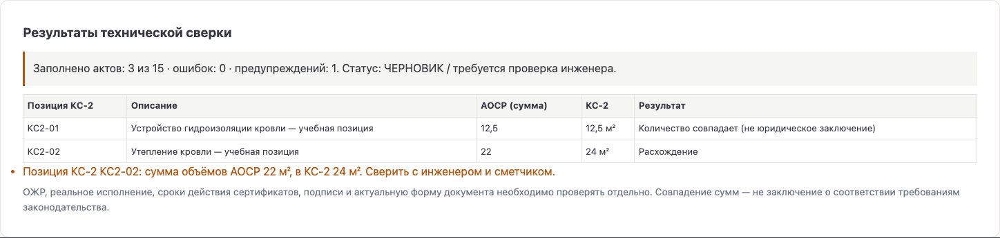

## 15 — Файловые вложения, SHA-256 и редакции

**Purpose:** Locally stored certificate example, SHA-256 and revision.

**Visible buttons (sample):** Загрузить вымышленный пример, Сохранить JSON, Печатные черновики (HTML), Экспорт АОСР в Excel (.xlsx), Комплект актов для печати (.xlsx), Собрать комплект ИД с приложениями (.zip), Добавить позицию вручную, Скачать образец CSV, Удалить

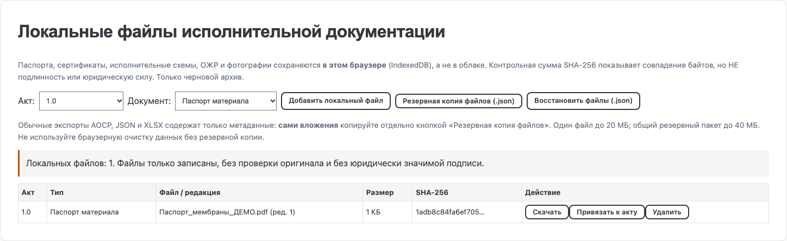

## 16 — Импорт ОЖР: сопоставление колонок, принятые и отклонённые строки

**Purpose:** OJR mapping, preview of accepted/rejected rows before committing.

**Visible buttons (sample):** Загрузить вымышленный пример, Сохранить JSON, Печатные черновики (HTML), Экспорт АОСР в Excel (.xlsx), Комплект актов для печати (.xlsx), Собрать комплект ИД с приложениями (.zip), Добавить позицию вручную, Скачать образец CSV, Удалить

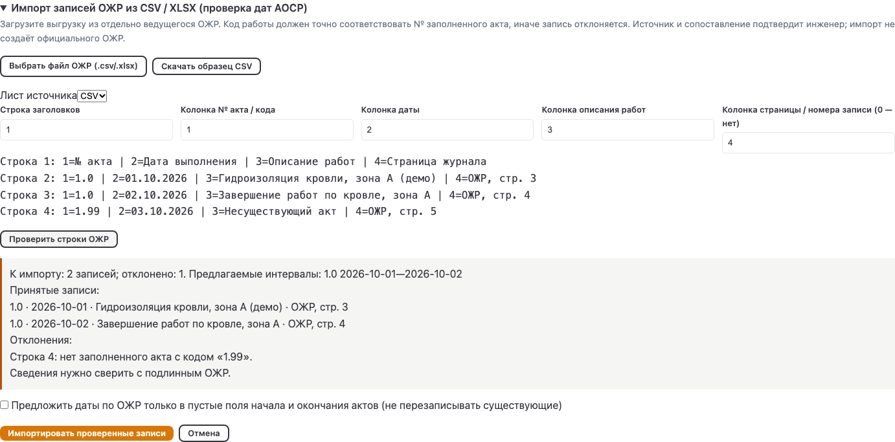

## 17 — Реестры ОЖР, паспортов и схем, контроль комплектности

**Purpose:** Work journal, certificates, schemes and readiness table.

**Visible buttons (sample):** Загрузить вымышленный пример, Сохранить JSON, Печатные черновики (HTML), Экспорт АОСР в Excel (.xlsx), Комплект актов для печати (.xlsx), Собрать комплект ИД с приложениями (.zip), Добавить позицию вручную, Скачать образец CSV, Удалить

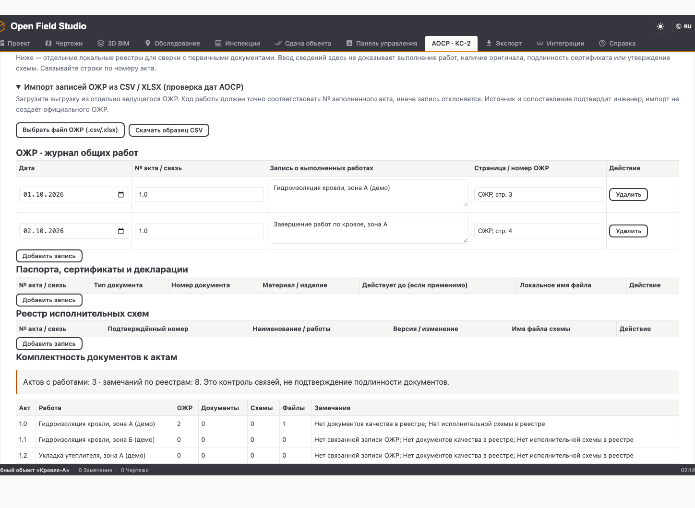

## 18 — Главный экран ПТО после импорта с предупреждениями

**Purpose:** Main AOSR controls and common project fields after OJR import.

**Visible buttons (sample):** Загрузить вымышленный пример, Сохранить JSON, Печатные черновики (HTML), Экспорт АОСР в Excel (.xlsx), Комплект актов для печати (.xlsx), Собрать комплект ИД с приложениями (.zip), Добавить позицию вручную, Скачать образец CSV, Удалить

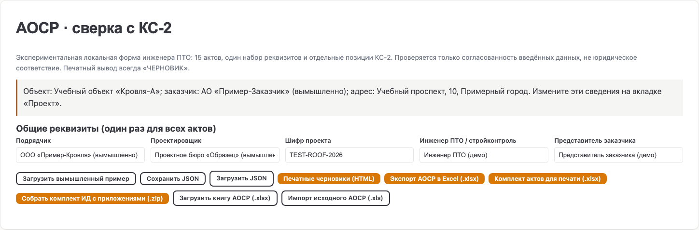

## 19 — Загруженный учебный план кровли

**Purpose:** Uploaded synthetic plan of the roof.

**Visible buttons (sample):** Выбрать, Удалить

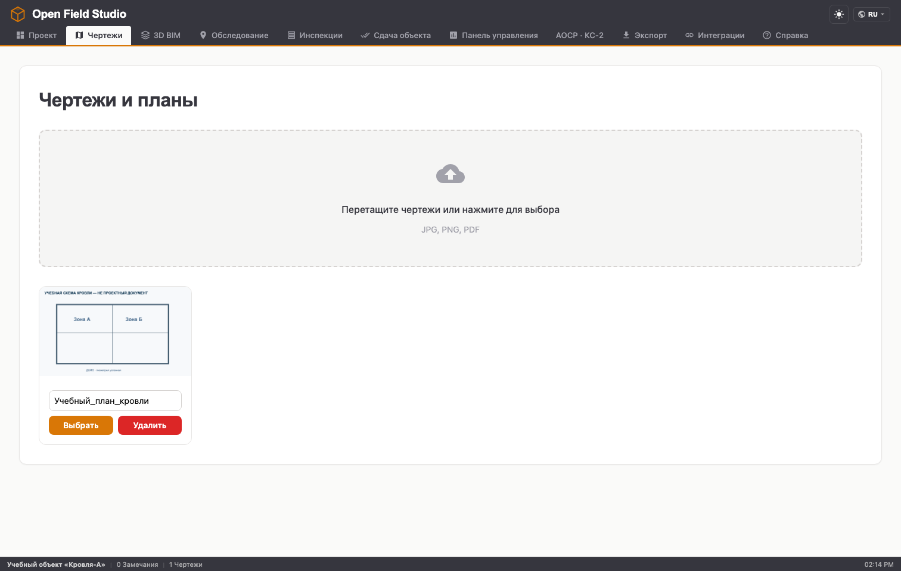

## 20 — Обследование с условным планом

**Purpose:** Survey using the fictional floor plan.

**Visible buttons (sample):** Добавить замечание

## 21 — Карточка замечания: описание, категория, приоритет и ответственный

**Purpose:** Ticket form: description, category, severity, priority and assignee.

**Visible buttons (sample):** Добавить замечание

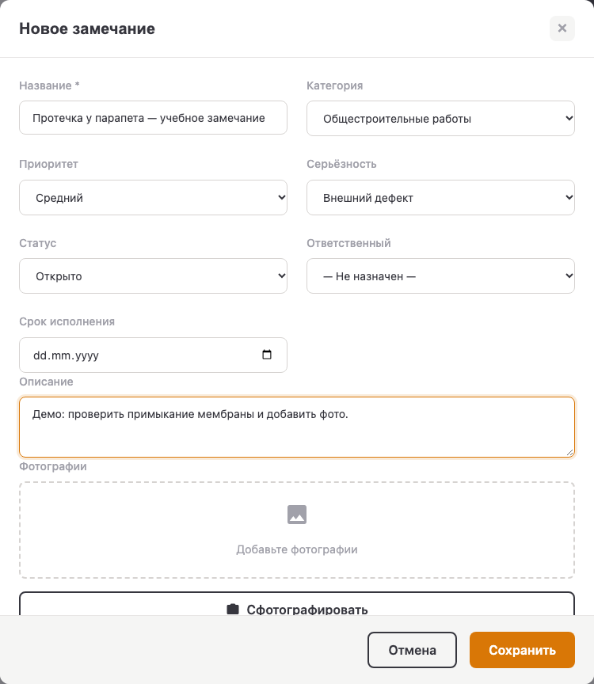

## 22 — Создание инспекции с выбором шаблона

**Purpose:** Inspection creation: checklist, date and employee.

**Visible buttons (sample):** Отмена, Начать инспекцию

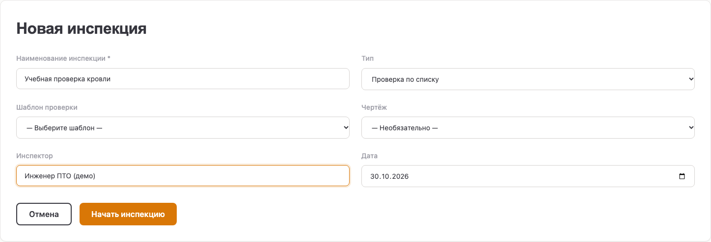

## 23 — Контрольный лист и ход выполнения инспекции

**Purpose:** Inspection execution with checklist statuses.

**Visible buttons (sample):** Назад, ✎ Редактировать, ✓, ✗, -, ← К списку, Завершить инспекцию

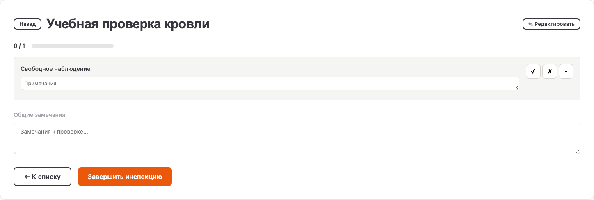

## 24 — Подготовка акта сдачи объекта, участники и дата

**Purpose:** Handover setup with participants, date and notes.

**Visible buttons (sample):** ×, + Добавить, Отмена, Начать оформление

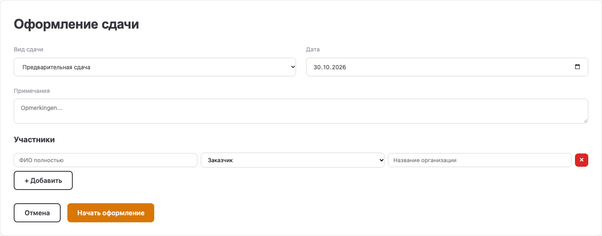

## 25 — Панель управления после создания демонстрационной инспекции

**Purpose:** Dashboard after beginning a synthetic inspection.

**Visible buttons (sample):** No buttons visible at capture

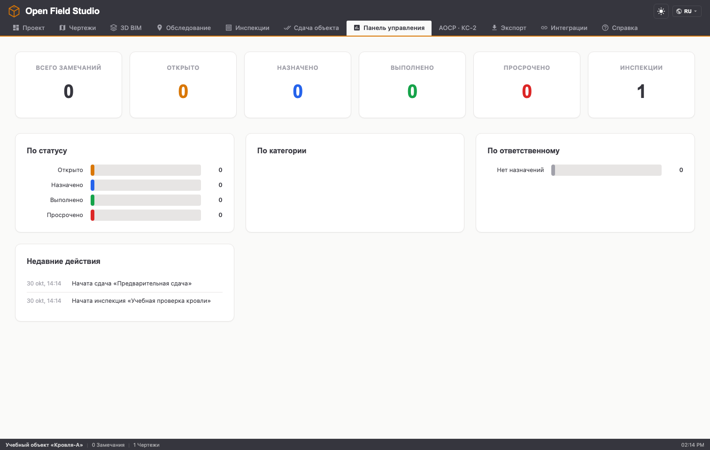

## 26 — Файлы и документы для исполнительного комплекта

**Purpose:** Evidence file reference panel.

**Visible buttons (sample):** Загрузить вымышленный пример, Сохранить JSON, Печатные черновики (HTML), Экспорт АОСР в Excel (.xlsx), Комплект актов для печати (.xlsx), Собрать комплект ИД с приложениями (.zip), Добавить позицию вручную, Скачать образец CSV, Удалить

## 27 — Экран подписи инспекции (НЕ УКЭП)

**Purpose:** Inspection drawn-signature UI; not a Russian legal e-signature.

**Visible buttons (sample):** Очистить, Отмена, Подписать и завершить

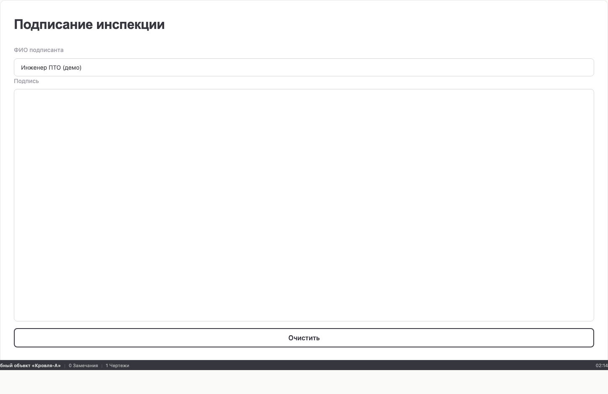

## 28 — Проверка пунктов сдачи и вложений

**Purpose:** Handover item checklist; no statutory acceptance has occurred.

**Visible buttons (sample):** Назад, Завершить и подписать

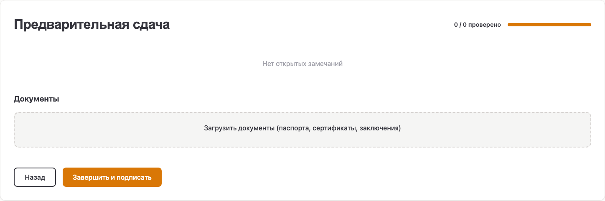

## 29 — Экран завершения сдачи (не юридически значимая ЭП)

**Purpose:** Handover verdict and signature fields; not qualified e-signatures.

**Visible buttons (sample):** Очистить, + Добавить подпись, Назад, Подписать и завершить

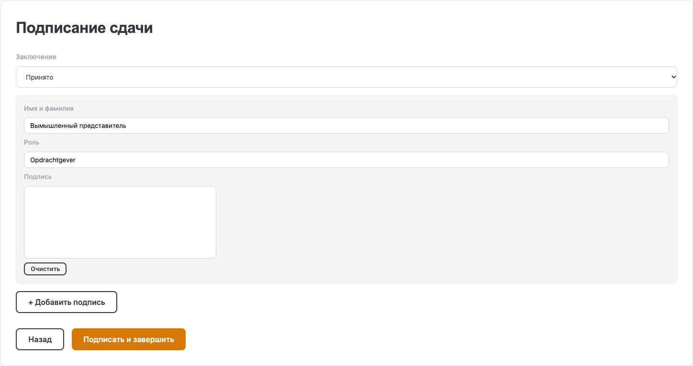

## 30 — Карточка участника проекта

**Purpose:** Project contact editor and roles.

**Visible buttons (sample):** Найти адрес (BAG Нидерланды), Импорт из интеграции, + Добавить участника, Сохранить проект

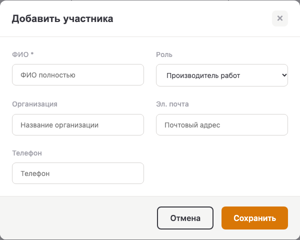

## Critical boundaries

1. PTO documents and ZIP packs remain drafts until verified and accepted by authorised construction personnel.
2. Canvas drawn signature is not УКЭП/УНЭП, and the interface does not constitute formal Russian electronic executive-document submission.
3. Foreign-market BAG lookup, connector brands and selected technical standards need adaptation before use as a domestic construction platform.
4. Real IFC loading, external connector transmissions and customer-approved print/paper handover were not audited by these screenshots.

## 31 — Российская справка адресов (ФИАС / ГАР)

**Purpose:** Russian locale shows the manual link to the official FNS address register. The operator checks the address there and enters the verified details themselves; no automatic FIAS API requests, FIAS ID or authenticity stamp are generated by the app.

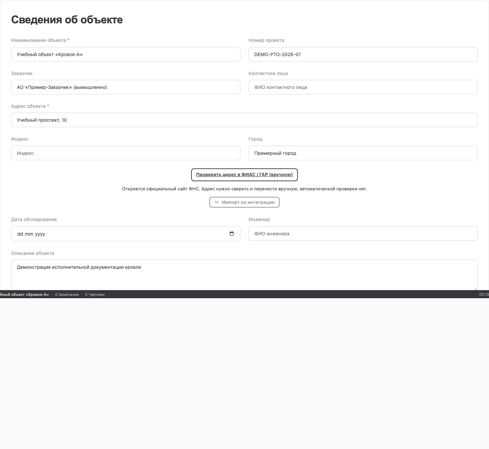

## 32 — Предупреждение о зарубежных интеграциях

**Purpose:** In Russian mode, the interface explicitly states that inherited international provider connections are not validated integrations with 1С, Exon or ГРАНД-Смета. Existing configuration options remain available for organisations knowingly using those providers.

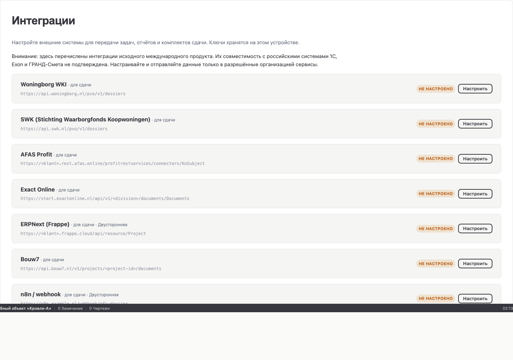

## 33 — АОСР: все графы

**Purpose:** the original ten-column act editor remains available through **«Все графы — подробный режим»**. It edits quantities, units, КС-2 links and all the original act fields; values are shared with compact input.

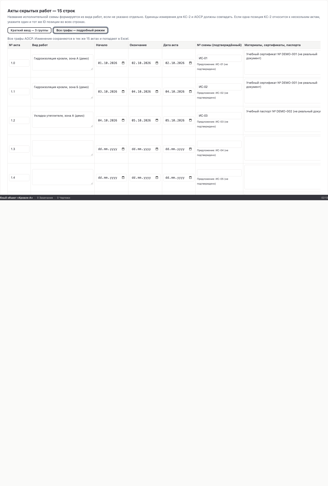

## 34 — АОСР: краткий ввод акта

**Purpose:** default **«Краткий ввод — 3 группы»** covers work, dates, confirmed scheme number and material passports. Suggested ИС-01 is NOT a verified scheme and is not automatically assigned.

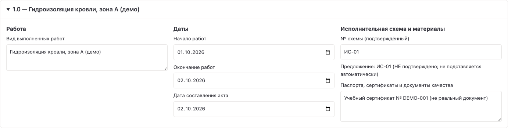
