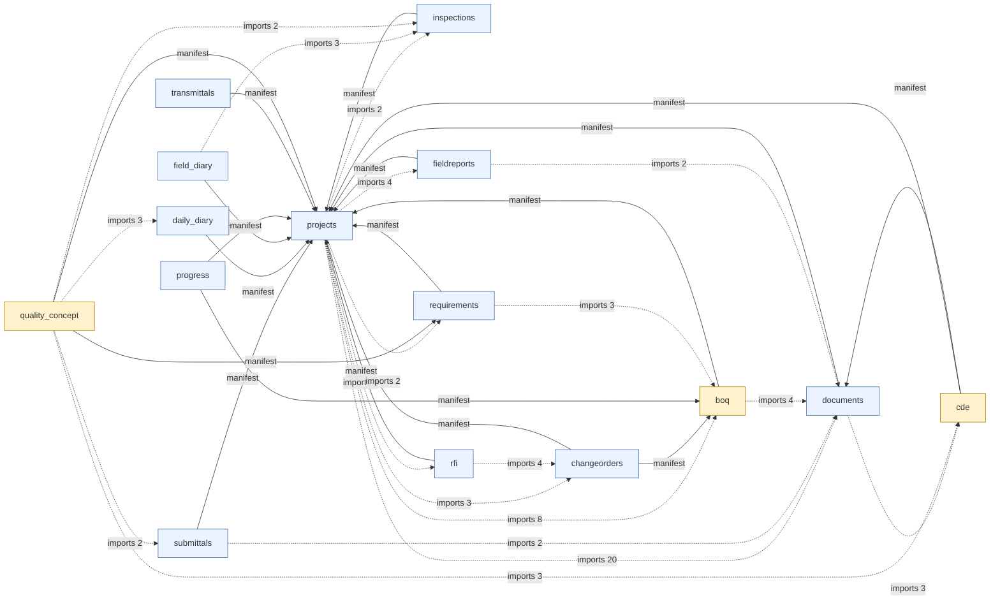

# Static Code Graph: OpenConstructionERP → PTO research

**Upstream commit:** 6032873c58e930e420af3d7fd483b61ea1b246d3. **Scope:** 20 checked-out source modules; this diagram displays 15.

Arrows labelled **manifest** are declared module dependencies. Dashed **imports N** arrows count Python `from app.modules...` import statements in selected files (not calls or runtime events). External modules and most of the ERP are intentionally omitted from the drawing; the full declared dependency lists and observed imports are in [CODE_GRAPH.json](CODE_GRAPH.json).

## Source-derived graph

## Most important coupling observations

- The lightweight `daily_diary` and `submittals` manifests each declare only projects and users, but their source code also imports other subsystems; independent copy/paste would be misleading.
- The `progress` manifest depends on `boq`, which is large and internally imports many modules. Prefer implementing a small local quantity reconciliation contract.
- The `cde` manifest directly depends on `documents`, and its service also uses versioning and approval systems. Its role-based published-state gate cannot be safely reduced to a local checkbox.
- `quality_concept` has many governance and commissioning dependencies. Treat its evidence-linking and state-machine approach as architectural reference, not a drop-in АОСР compliance engine.

## Reproduce

Run the sibling [build_code_graph.py](build_code_graph.py) against the pinned sparse checkout. It parses manifests and imports without executing upstream software. See the [phased integration plan](INTEGRATION_PLAN.md) and the original [AGPL-3.0 license](https://github.com/datadrivenconstruction/OpenConstructionERP/blob/6032873c58e930e420af3d7fd483b61ea1b246d3/LICENSE).
